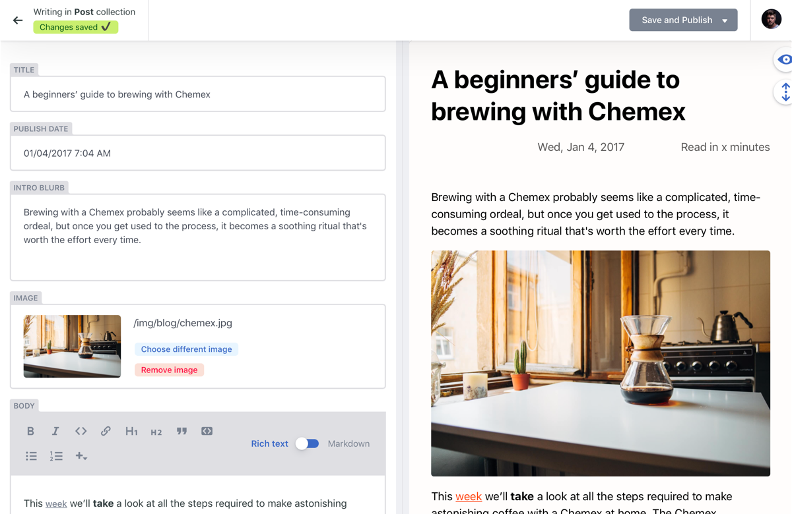
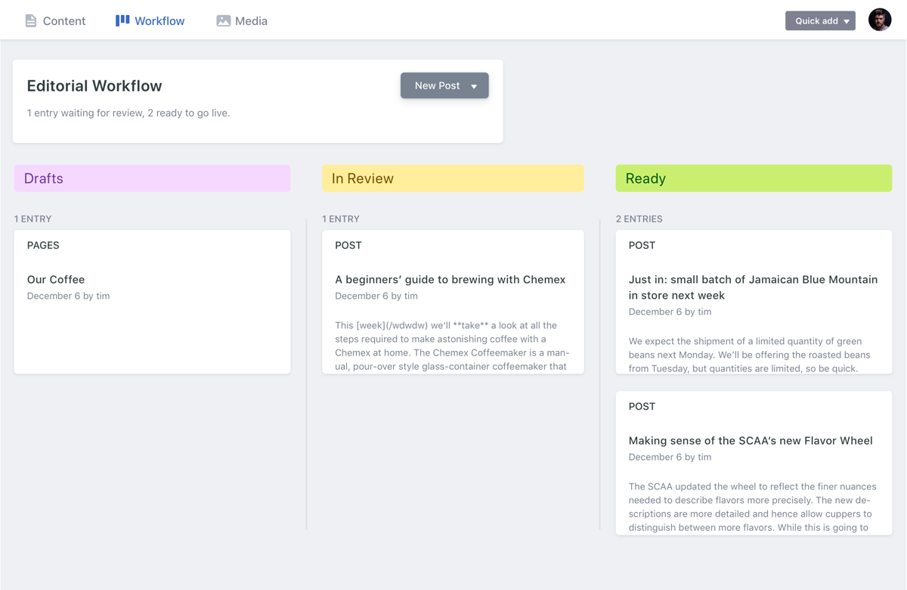

# Feuerwehr Untereisesheim — Website

Offizielle Website der Freiwilligen Feuerwehr Untereisesheim.

**Technologie-Stack:** Eleventy · Tailwind CSS · Alpine.js · Decap CMS  
**Hosting:** Noch nicht entschieden — Optionen siehe [Abschnitt 4](#4-hosting-optionen-im-vergleich)

> **GitHub Pages** ist als Test konfiguriert (`.github/workflows/deploy.yml`), aber noch kein finales Hosting.
> GitHub Pages deaktivieren: Repository → Settings → Pages → Source → **None**

---

## Inhaltsverzeichnis

1. [Technischer Aufbau](#1-technischer-aufbau)
2. [Inhalte pflegen — ohne Programmierkenntnisse](#2-inhalte-pflegen--ohne-programmierkenntnisse)
3. [Lokale Entwicklung](#3-lokale-entwicklung)
4. [Hosting-Optionen im Vergleich](#4-hosting-optionen-im-vergleich)
5. [CMS-Einrichtung für nicht-technische Nutzer](#5-cms-einrichtung-für-nicht-technische-nutzer)
6. [Bilder & Mediendateien](#6-bilder--mediendateien)
7. [Dateistruktur](#7-dateistruktur)
8. [Eigene Domain mit Netlify](#8-eigene-domain-mit-netlify)
9. [Google Analytics / Besucherstatistiken](#9-google-analytics--besucherstatistiken)
10. [Alternative: Website-Baukästen](#10-alternative-website-baukästen)

---

## 1. Technischer Aufbau

### Wie die Website funktioniert

```
Quelldateien (src/)  →  Eleventy baut HTML  →  _site/  →  GitHub Actions  →  Live
```

Die Website ist **vollständig statisch** — kein Server, keine Datenbank, kein PHP.
Eleventy liest YAML-Datendateien und HTML-Templates, baut daraus fertiges HTML und
Tailwind CSS generiert das Stylesheet. Das Ergebnis (`_site/`) sind reine HTML/CSS/JS-Dateien,
die direkt auf jedem Webserver oder CDN liegen können.

### Automatisches Deployment

Jedes Mal wenn ein Commit auf den `main`-Branch gepusht wird, baut GitHub Actions die Seite
automatisch und veröffentlicht sie auf GitHub Pages. Das dauert ca. 1–2 Minuten.

```
Git Push → GitHub Actions workflow → npm run build → GitHub Pages live
```

### Verwendete Technologien

| Technologie | Version | Aufgabe |
|---|---|---|
| [Eleventy](https://www.11ty.dev/) | 1.x | Static Site Generator — baut HTML aus Templates + YAML |
| [Tailwind CSS](https://tailwindcss.com/) | 3.x | CSS-Framework — Styling der Seite |
| [Alpine.js](https://alpinejs.dev/) | 3.x | Minimales JS — Mobilmenü, Team-Tabs, Scroll-Button |
| [Decap CMS](https://decapcms.org/) | CDN | Optionales Browser-CMS unter `/admin/` |
| [GitHub Actions](https://github.com/features/actions) | — | Automatisches Bauen und Deployen |
| [GitHub Pages](https://pages.github.com/) | — | Aktuelles Hosting (kostenlos) |

---

## 2. Inhalte pflegen — ohne Programmierkenntnisse

### Methode A: Direkt auf GitHub.com (empfohlen für den Anfang)

Kein Programm nötig — nur ein Browser und ein GitHub-Account.

**Schritt-für-Schritt am Beispiel „Neuen Termin eintragen":**

1. Gehe zu [github.com](https://github.com) und melde dich an
2. Öffne das Repository der Feuerwehr
3. Navigiere zu `src/_data/events.yaml`
4. Klicke auf das **Stift-Symbol** (✏️ oben rechts in der Dateiansicht)
5. Füge einen neuen Termin im bestehenden Format ein:
   ```yaml
   - title: Jahreshauptversammlung
     day: "15"
     month: "Nov"
     time: "19:00 Uhr"
     type: Veranstaltung
     description: Jährliche Hauptversammlung der Feuerwehr Untereisesheim
   ```
6. Klicke unten auf **"Commit changes"** → kurze Beschreibung eingeben → **"Commit changes"**
7. Die Seite wird automatisch aktualisiert — fertig in ca. 2 Minuten

**Welche Dateien wofür zuständig sind:**

| Inhalt | Datei auf GitHub |
|---|---|
| Termine / Veranstaltungen | `src/_data/events.yaml` |
| Mannschaft (Namen, Rollen, Fotos) | `src/_data/mannschaft.yaml` |
| Fahrzeuge | `src/_data/vehicles.yaml` |
| Navigationsmenü | `src/_data/navigation.yaml` |
| Seitenname, URL, Autor | `src/_data/settings.yaml` |
| Neuigkeiten / Einsatzberichte | `src/posts/*.md` (neue Datei erstellen) |

### Methode B: Decap CMS Browser-Editor (nach Einrichtung)

Nach einer einmaligen Einrichtung können Inhalte über eine komfortable Web-Oberfläche
gepflegt werden — ohne Programmierkenntnisse und ohne GitHub-Kenntnisse.

→ Einrichtungsanleitung unter [Abschnitt 5](#5-cms-einrichtung-für-nicht-technische-nutzer)

### Neuen Einsatzbericht schreiben

Einsatzberichte (Blog-Posts) sind Markdown-Dateien unter `src/posts/`.

**Neue Datei auf GitHub erstellen:**

1. Gehe zu `src/posts/`
2. Klicke auf **"Add file" → "Create new file"**
3. Dateiname: `2026-11-09-einsatz-wohnhausbrand.md` (Datum-Titel-Format)
4. Inhalt:
   ```markdown
   ---
   title: Wohnhausbrand in der Hauptstraße
   description: Kurzbeschreibung für die Vorschau auf der Startseite
   author: Max Mustermann
   date: 2026-11-09
   tags:
     - Einsatz
   ---

   Hier kommt der Bericht in normalem Text. **Fett** und *kursiv* funktionieren.

   Weitere Details zum Einsatz...
   ```
5. **Commit changes** → Seite aktualisiert sich automatisch

---

## 3. Lokale Entwicklung

Für Änderungen am Design, Layout oder Code.

**Voraussetzungen:** Node.js 20+ und npm (inkludiert)

```bash
# Repository klonen
git clone https://github.com/[username]/feuerwehr-untereisesheim.git
cd feuerwehr-untereisesheim

# Abhängigkeiten installieren
npm install

# Entwicklungsserver starten (http://localhost:8080)
npm start

# Produktions-Build (gleich wie GitHub Actions)
npm run build
```

**Wichtige Skripte:**

| Befehl | Funktion |
|---|---|
| `npm start` | Entwicklungsserver mit Live-Reload |
| `npm run build` | Einmaliger Produktions-Build nach `_site/` |

**Verzeichnisse:**

- `src/` — alle Quelldateien (hier arbeiten)
- `_site/` — gebaute Seite (wird von Git ignoriert, nie direkt bearbeiten)
- `.github/workflows/deploy.yml` — GitHub Actions Pipeline

---

## 4. Hosting-Optionen im Vergleich

> **Kontext:** Die Seite hat ca. 1.100 Aufrufe pro Monat (~37 pro Tag).
> Das entspricht ~220 MB/Monat Bandbreite (bei 200 kB Seitengröße) — für alle Optionen problemlos beherrschbar.

### Übersicht

| Option | Kosten | Bilder | CMS | Aufwand | Empfehlung |
|---|---|---|---|---|---|
| **GitHub Pages** *(Test, noch kein Ziel)* | Kostenlos | Im Git-Repo (bis ~500 MB gut) | Nur direkte Dateibearbeitung oder GitHub OAuth | Gering | Nur für Entwicklertests |
| **Netlify** | Kostenlos (Free Tier) | Im Git-Repo + Netlify CDN | Decap CMS out-of-the-box | Mittel | ✅ Beste CMS-Integration |
| **Cloudflare Pages** | Kostenlos | Im Git-Repo | GitHub OAuth Proxy nötig | Mittel | ✅ Schnellstes CDN |
| **Vercel** | Kostenlos (Hobby) | Im Git-Repo | GitHub OAuth Proxy nötig | Mittel | Gut, aber CMS komplex |
| **VHUG** | Bestehende Beziehung | Auf dem Server | Kein CMS | Gering | ✅ Bestehende Beziehung, manuelles Deploy |

---

### Option 1: GitHub Pages (Test-Setup, aktuell konfiguriert)

**Status:** Nur als Test eingerichtet — noch kein finales Hosting.  
**Deaktivieren:** Repository → Settings → Pages → Source → **None**

**Kosten:** Vollständig kostenlos für öffentliche Repositories

**Wie es funktioniert:**
- GitHub Actions baut die Seite bei jedem Push automatisch
- Fertig gebautes `_site/` wird auf GitHub Pages veröffentlicht
- Bereits konfiguriert und aktiv (`.github/workflows/deploy.yml`)

**Bilder:**
- Bilder liegen im Git-Repository unter `src/static/img/`
- GitHub empfiehlt Repository-Größe unter 1 GB; Fotos für eine Feuerwehr-Website passen problemlos rein
- Grenze: Einzelne Datei max. 100 MB; Gesamtrepository praktisch bis ca. 2–3 GB nutzbar

**CMS für nicht-technische Nutzer:**
- Ohne weiteres Setup: Dateien direkt auf GitHub.com bearbeiten (Stift-Icon)
- Mit GitHub OAuth Proxy: Decap CMS wie bei Netlify — einmalige Einrichtung, dann Browser-Editor

**Domain:**
- Standard: `https://[username].github.io/feuerwehr-untereisesheim/`
- Eigene Domain (z. B. `www.feuerwehr-untereisesheim.de`): In den Repository-Settings unter "Pages" eintragen, danach DNS-Eintrag beim Domain-Anbieter setzen

---

### Option 2: Netlify

**Kosten:**

| Plan | Preis | Bandbreite | Build-Minuten | Netlify Identity |
|---|---|---|---|---|
| Starter (Free) | $0/Monat | 100 GB/Monat | 300 min/Monat | 1.000 aktive Nutzer kostenlos |
| Pro | $19/Monat | 400 GB/Monat | 1.000 min/Monat | 5.000 aktive Nutzer |

→ **Free Tier reicht für die Feuerwehr-Website vollständig aus** (1.100 Besuche/Monat = ~220 MB/Monat Bandbreite — 0,2 % des 100 GB Limits)

**Wie es funktioniert:**
- Netlify verbindet sich mit GitHub, baut automatisch bei jedem Push
- Build-Befehl und Verzeichnis sind bereits in `netlify.toml` konfiguriert

**Bilder:**
- Bilder werden im Git-Repository gespeichert (wie GitHub Pages)
- Netlify liefert sie über sein eigenes CDN aus — keine extra Kosten

**CMS für nicht-technische Nutzer:**
- **Beste CMS-Integration aller Optionen**
- Decap CMS funktioniert sofort mit Netlify Identity + Git Gateway
- Nutzer meldet sich unter `/admin/` an, bearbeitet Inhalte im Browser, Netlify committed automatisch nach GitHub

**Einrichtung (Schritt für Schritt):**
1. Netlify-Account anlegen unter [netlify.com](https://netlify.com)
2. "Add new site" → "Import from Git" → GitHub-Repo auswählen
3. Build-Einstellungen werden aus `netlify.toml` automatisch erkannt
4. Netlify deployed sofort auf eine kostenlose Subdomain (z. B. `feuerwehr-untereisesheim.netlify.app`) — eigene Domain bleibt vorerst unberührt
5. CMS testen: Identity und Git Gateway aktivieren (je ein Klick), Nutzer einladen, `/admin/` öffnen
6. Wenn alles passt: eigene Domain eintragen und DNS umstellen (siehe unten)

**Eigene Domain einrichten:**

1. **Netlify Dashboard → Site → Domain management → "Add a domain"** → Domain eingeben (z. B. `feuerwehr-untereisesheim.de`)
2. Netlify zeigt die benötigten DNS-Einträge an
3. Beim **Domain-Anbieter** (wo die Domain registriert ist) folgende Einträge setzen:

| Zweck | Eintragstyp | Wert |
|---|---|---|
| Hauptdomain (`feuerwehr-untereisesheim.de`) | `A` | `75.2.60.5` |
| Mit www (`www.feuerwehr-untereisesheim.de`) | `CNAME` | `[sitename].netlify.app` |

4. DNS-Propagierung dauert meist unter einer Stunde (maximal 48 Stunden)
5. **SSL/HTTPS:** Netlify richtet automatisch ein kostenloses Let's Encrypt-Zertifikat ein — kein weiterer Schritt nötig

> **Tipp:** Domain und Netlify können parallel betrieben werden. Solange die DNS-Einträge nicht geändert werden, ist die Seite nur unter `*.netlify.app` erreichbar — die echte Domain zeigt weiterhin auf den alten Anbieter. Der Wechsel passiert erst mit dem DNS-Update.

---

### Option 3: Cloudflare Pages

**Kosten:**

| Plan | Preis | Bandbreite | Builds |
|---|---|---|---|
| Free | $0/Monat | Unbegrenzt | 500 Builds/Monat |
| Pro | $20/Monat | Unbegrenzt | 5.000 Builds/Monat |

**Bilder:**
- Bilder im Git-Repository: kostenlos, keine Begrenzung auf Cloudflare-Seite
- Cloudflare Images (optionaler Zusatzdienst): $5/Monat für 100.000 gespeicherte/gelieferte Bilder — für eine Feuerwehr-Website nicht nötig

**CMS für nicht-technische Nutzer:**
- Kein eingebautes Identity-System wie Netlify
- Decap CMS möglich, aber GitHub OAuth Proxy muss separat eingerichtet werden (kostenlos auf Cloudflare Workers möglich — ca. 30 Minuten Einrichtungsaufwand)

**Vorteil gegenüber anderen:** Cloudflares CDN ist das schnellste weltweit — für eine lokale Feuerwehr-Website aber irrelevant.

---

### Option 4: Synology NAS (Selbst-Hosting)

**Kosten:** Keine laufenden Kosten, wenn die Hardware bereits vorhanden ist

**Wie es funktioniert:**
- Synology DSM (das Betriebssystem der NAS) enthält **Web Station** — einen eingebauten Nginx/Apache-Webserver
- Statische HTML-Dateien (`_site/`) werden auf die NAS kopiert und direkt ausgeliefert
- Kein Cloud-Service, keine monatlichen Kosten, vollständige Datenkontrolle

**Performance-Einschätzung für 1.100 Aufrufe/Monat (~37/Tag):**

| Kennzahl | Wert | Bewertung |
|---|---|---|
| Durchschnittliche Last | ~1,5 Besuche/Stunde | Minimal |
| Bandbreite/Monat | ~220 MB | Beliebiger DSL-Anschluss liefert das |
| Peaks (z. B. nach Einsatz) | max. 20–30 gleichzeitig | ~4–6 MB/s Upload reicht aus |
| Benötigter Upload | ~1 Mbit/s dauerhaft | Jeder Heimanschluss ab 10 Mbit/s ausreichend |

→ **Technisch: Ja, eine Synology NAS kann diesen Traffic problemlos bewältigen.**

Die eigentliche Frage ist nicht Leistung, sondern **Zuverlässigkeit**:
- Heiminternet fällt typischerweise 5–20 Minuten/Monat aus (Router-Neustart, Leitungsstörung)
- Stromausfall → NAS offline (lösbar mit USV / Unterbrechungsfreier Stromversorgung, ~€80)
- IP-Adresse ändert sich bei DSL/Kabel gelegentlich → DDNS nötig (kostenlos über Synology)

**Einrichtung:**

```
1. NAS: Synology Web Station aktivieren (DSM → Package Center)
2. NAS: Port 80/443 öffnen (Router-Portweiterleitung)
3. Domain: DNS-A-Record auf die öffentliche IP der NAS zeigen
4. NAS: Let's Encrypt-Zertifikat aktivieren (DSM → Systemsteuerung → Sicherheit → Zertifikat)
5. Deployment: Lokalen Build nach /volume1/web/ kopieren (rsync oder SCP)
```

**Bilder:**
- Bilder liegen auf der NAS — unbegrenzt (durch verfügbaren Speicherplatz bestimmt)
- Vorteil: Kein Limit, kein Upload zu Dritten

**CMS für nicht-technische Nutzer:**
- Kein automatisches CMS out-of-the-box
- Möglichkeit 1: Dateien auf GitHub bearbeiten → manuelle Deployment-Pipeline nötig
- Möglichkeit 2: NAS als primäres Deployment mit automatischem Git-Pull über Cron-Job (fortgeschritten)
- Möglichkeit 3: Dateien direkt über Synology Drive oder SMB bearbeiten (nur für technisch versierte Nutzer)

**Einschränkungen:**
- Abhängig von der Internetverbindung und dem Stromausfall-Schutz am NAS-Standort
- Manuelle Updates bei NAS-Betriebssystem-Sicherheitslücken nötig
- SSL-Zertifikat alle 90 Tage erneuern (automatisch mit Let's Encrypt, aber muss eingerichtet sein)
- Bei DSL/Kabel-Anschluss: IP-Adresse ändert sich gelegentlich → DDNS-Dienst nötig (Synology bietet kostenlose `*.synology.me`-Subdomain an)

**Für wen geeignet:**
- Wenn ein Feuerwehrmitglied bereits eine Synology NAS besitzt und die Infrastruktur kennt
- Als Backup-Option oder zum Testen
- Wenn absolute Datensouveränität gewünscht ist (alle Daten bleiben lokal)

---

### Option 5: VHUG (bestehende Beziehung)

**Wie es funktioniert:**
Die Seite wird lokal gebaut und die fertigen HTML-Dateien per rsync oder FTP auf den VHUG-Server hochgeladen.

```
npm run build  →  _site/  →  rsync/FTP auf VHUG-Server  →  Live
```

**Deployment einrichten (einmalig):**

1. VHUG nach Zugangsdaten fragen: SSH-Benutzername, Hostname, Webroot-Pfad
2. Werte in `.env` eintragen (Vorlage: `.env.example`):
   ```
   VHUG_USER=username
   VHUG_HOST=server.vhug.tech
   VHUG_PATH=/var/www/feuerwehr/
   ```
3. Erstes Deployment:
   ```bash
   npm run deploy
   ```

**Was `npm run deploy` macht:**
1. Baut die Seite nach `_site/`
2. Überträgt per rsync nur geänderte Dateien auf den Server — löscht auch Dateien, die lokal entfernt wurden

**Falls nur FTP verfügbar (kein SSH):**
Dateien aus `_site/` manuell hochladen mit [Cyberduck](https://cyberduck.io) (Mac) oder [FileZilla](https://filezilla-project.org).

**CMS für nicht-technische Nutzer:** ❌ Nicht direkt — Inhalte werden über GitHub.com oder lokal bearbeitet, dann manuell deployed.

**Eigene Domain:** VHUG konfiguriert das direkt — bestehende Beziehung nutzen.

---

### Empfehlung

| Szenario | Empfehlung |
|---|---|
| Nur Entwickler pflegen die Seite | **GitHub Pages** (aktuell, kostenlos, kein Aufwand) |
| Feuerwehrmitglieder sollen selbst Inhalte pflegen | **Netlify Free Tier** (einfachste CMS-Integration) |
| Maximale Geschwindigkeit + kostenlos + kein CMS nötig | **Cloudflare Pages** |
| Synology NAS vorhanden, volle Kontrolle, kein monatlicher Kostenwunsch | **Synology NAS** ✅ technisch ausreichend für 1.100 Besuche/Monat — Zuverlässigkeit (USV + DDNS) einplanen |

---

## 5. CMS-Einrichtung für nicht-technische Nutzer

Decap CMS ist bereits im Projekt vorhanden (`src/admin/`). Es fehlt nur die Authentifizierung.

### So sieht das CMS aus

**Einsatzbericht schreiben — Editor mit Live-Vorschau:**



Links: Formularfelder (Titel, Datum, Text-Editor mit Formatierung).
Rechts: Live-Vorschau des fertigen Beitrags. Oben rechts: "Save and Publish"-Button.

**Optionaler Review-Prozess (Entwurf → Prüfung → Veröffentlichung):**



Beiträge können als Entwurf gespeichert, von einer zweiten Person geprüft und dann freigegeben werden. Für eine Feuerwehr-Website kann dieser Schritt übersprungen werden — direkt "Save and Publish" reicht.

---

### Option A: Netlify Identity (einfachste Einrichtung)

**Einmalige Einrichtung durch Entwickler (ca. 15 Minuten):**

1. [Netlify-Account](https://netlify.com) erstellen und Seite von GitHub importieren
2. **Netlify Dashboard → Site → Integrations → Identity → Enable**
3. **Netlify Dashboard → Site → Integrations → Identity → Git Gateway → Enable**
4. Nutzer einladen: **Identity-Tab → Invite users** → E-Mail-Adresse eingeben
5. Eingeladene Person erhält eine E-Mail, klickt auf den Link, setzt ein Passwort

**Danach können Feuerwehrmitglieder:**
- `https://www.feuerwehr-untereisesheim.de/admin/` aufrufen
- Mit E-Mail + Passwort einloggen
- Termine, Mannschaft, Blog-Posts über eine grafische Oberfläche bearbeiten
- Fotos hochladen (werden automatisch ins GitHub-Repo committed)
- Seite aktualisiert sich automatisch nach dem Speichern

**Was Nutzer sehen im CMS:**

```
Inhalt bearbeiten
├── Blog (Aktuelles/Einsatzberichte)
│   ├── Neuer Beitrag
│   └── Bestehende Beiträge bearbeiten
├── Einstellungen
│   ├── Navigation
│   └── Seiten-Metadaten
└── Mannschaft
    └── Mitglieder (Aktive, Jugend, Altersabteilung)
```

> Hinweis: Termine (events.yaml) und Fahrzeuge (vehicles.yaml) sind noch nicht im CMS konfiguriert.
> Können in `src/admin/config.yml` ergänzt werden (ca. 20 Zeilen pro Datei — kurze Entwicklerarbeit).

### Option B: GitHub OAuth (für GitHub Pages / Cloudflare Pages)

Funktioniert ohne Netlify, erfordert aber die Einrichtung eines kleinen OAuth-Proxy-Dienstes.
Geeignet wenn GitHub Pages als Hosting behalten werden soll.

Anleitung: [Decap CMS mit GitHub Backend](https://decapcms.org/docs/github-backend/)

---

## 6. Bilder & Mediendateien

### Aktueller Stand

Bilder werden im Git-Repository unter `src/static/img/` gespeichert.
Eleventy kopiert sie unverändert nach `_site/static/img/`.

**Speicherpfad für Fotos im CMS:** `/static/img/`  
**Empfohlene Dateiformate:** `.jpg` für Fotos, `.png` für Logos/Icons, `.webp` für beste Performance

### Praktische Grenzen

| Hosting | Bilderspeicher | Praktische Grenze |
|---|---|---|
| GitHub Pages | Git-Repository | ~500 MB gut nutzbar; bis ~2 GB technisch möglich |
| Netlify | Git-Repository + CDN-Auslieferung | Gleiche Git-Grenze; Auslieferung kostenlos |
| Cloudflare Pages | Git-Repository | Gleiche Git-Grenze |
| Synology NAS | Lokale Festplatte | Unbegrenzt (durch NAS-Speicher bestimmt) |

### Wann ist externes Bildspeichern sinnvoll?

Für eine Feuerwehr-Website mit 1.100 Besuchen/Monat und normalem Fotobedarf
(Übungsfotos, Einsatzberichte, Teamfotos) ist das Git-Repository vollständig ausreichend.

**Richtwert:** 500 Fotos à 2 MB = 1 GB — das ist die einzige Grenze, die relevant werden könnte.

Falls zukünftig sehr viele Fotos (Jahrzehnte an Archivmaterial) hochgeladen werden sollen:

- **Cloudinary Free Tier:** 25 GB Speicher, 25 GB Bandbreite/Monat, kostenlos
- **GitHub LFS:** $5/Monat für 50 GB extra Speicher + Bandbreite
- **Synology NAS:** unbegrenzt lokal, eigene Auslieferung

### Bilder optimieren (Empfehlung)

Fotos vor dem Upload auf max. 1.500 px Breite und ~300 kB verkleinern.  
Kostenlose Tools: [Squoosh](https://squoosh.app) (Browser), [ImageOptim](https://imageoptim.com) (Mac)

---

## 7. Dateistruktur

```
feuerwehr-untereisesheim/
│
├── src/                          ← Alle Quelldateien (hier wird gearbeitet)
│   ├── _data/                    ← Inhaltsdaten als YAML
│   │   ├── events.yaml           ← Termine & Veranstaltungen
│   │   ├── mannschaft.yaml       ← Mannschaft (Aktive, Jugend, Alters)
│   │   ├── vehicles.yaml         ← Fahrzeuge
│   │   ├── navigation.yaml       ← Navigationsmenü
│   │   └── settings.yaml         ← Seitenname, URL
│   │
│   ├── _includes/                ← Wiederverwendbare HTML-Bausteine
│   │   ├── default.html          ← Basis-Layout (Navbar, Footer)
│   │   ├── blog.html             ← Blog-Übersichtsseite
│   │   ├── posts.html            ← Einzelner Blog-Post
│   │   └── partials/
│   │       ├── navbar.html       ← Navigationsleiste
│   │       ├── footer.html       ← Fußzeile
│   │       └── content.html      ← Inhalt
│   │
│   ├── admin/                    ← Decap CMS
│   │   ├── config.yml            ← CMS-Konfiguration (Felder, Collections)
│   │   └── index.html            ← CMS-Login-Seite
│   │
│   ├── posts/                    ← Blog-Posts als Markdown
│   │   ├── posts.json            ← Geteilte Front-Matter für alle Posts
│   │   └── *.md                  ← Einzelne Beiträge
│   │
│   ├── static/
│   │   ├── css/tailwind.css      ← CSS-Einstiegspunkt
│   │   └── img/                  ← Bilder & Fotos
│   │
│   └── index.html                ← Komplette Startseite (alle Sektionen)
│
├── .github/workflows/deploy.yml  ← GitHub Actions Deployment-Pipeline
├── .eleventy.js                  ← Eleventy-Konfiguration
├── tailwind.config.js            ← Tailwind-Konfiguration
├── netlify.toml                  ← Netlify-Konfiguration (falls Wechsel gewünscht)
└── package.json                  ← Abhängigkeiten & Skripte
```

### YAML-Format Referenz

**Termin hinzufügen** (`src/_data/events.yaml`):
```yaml
- title: Name der Veranstaltung
  day: "15"           # Tag mit Anführungszeichen (wichtig für führende Null: "05")
  month: "Nov"        # Jan Feb Mär Apr Mai Jun Jul Aug Sep Okt Nov Dez
  time: "19:00 Uhr"
  type: Veranstaltung # oder: Übung, Einsatz
  description: Kurze Beschreibung
```

**Mannschaftsmitglied hinzufügen** (`src/_data/mannschaft.yaml`):
```yaml
- name: Vorname Nachname
  role: Gruppenführer
  image: ""           # Leer lassen für Platzhalter, oder: /static/img/name.jpg
```

**Fahrzeug hinzufügen** (`src/_data/vehicles.yaml`):
```yaml
- name: TSF-W
  type: Tragkraftspritzenfahrzeug-Wasser
  description: Beschreibung des Fahrzeugs.
  year: 2010
```

---

## 8. Eigene Domain mit Netlify

**Voraussetzung:** Netlify-Seite ist eingerichtet und läuft auf einer `*.netlify.app` Subdomain.

**Schritt 1 — Domain in Netlify eintragen:**

1. Netlify Dashboard → Site → **Domain management** → "Add a domain"
2. Domain eingeben (z. B. `feuerwehr-untereisesheim.de`) → bestätigen

**Schritt 2 — DNS-Einträge beim Domain-Anbieter setzen:**

| Zweck | Eintragstyp | Wert |
|---|---|---|
| Hauptdomain (`feuerwehr-untereisesheim.de`) | `A` | `75.2.60.5` |
| Mit www (`www.feuerwehr-untereisesheim.de`) | `CNAME` | `[sitename].netlify.app` |

**Schritt 3 — Warten:**
- DNS-Propagierung: meist unter einer Stunde, maximal 48 Stunden
- SSL/HTTPS-Zertifikat: Netlify richtet Let's Encrypt automatisch ein — kein weiterer Schritt nötig

> **Tipp:** Solange die DNS-Einträge nicht geändert sind, bleibt die echte Domain unberührt. Der Wechsel passiert erst mit dem DNS-Update — ideal zum risikofreien Vorbereiten.

---

## 9. Google Analytics / Besucherstatistiken

Google Analytics 4 (GA4) ist der aktuelle Standard für Websitestatistiken.
Es zeigt: Besucherzahlen, Gerät, Herkunft, meistbesuchte Seiten.

> **GDPR-Hinweis:** Für Besucher aus der EU ist eine Cookie-Einwilligung rechtlich erforderlich, wenn Tracking aktiv ist. Für eine Feuerwehr-Website mit rein öffentlichem Inhalt ist die Datenschutzrisiko gering — aber ein einfaches Cookie-Banner wird empfohlen. Alternative: **Plausible Analytics** (datenschutzkonform, kein Cookie-Banner nötig, kostenlose selbst-gehostete Version verfügbar).

### GA4 einbinden (einmalige Entwicklerarbeit, ~5 Minuten)

1. [Google Analytics-Account erstellen](https://analytics.google.com) → neue Property anlegen → Tracking-ID erhalten (Format: `G-XXXXXXXXXX`)

2. In [src/_includes/default.html](src/_includes/default.html) direkt vor `</head>` einfügen:

```html
<!-- Google Analytics -->
<script async src="https://www.googletagmanager.com/gtag/js?id=G-XXXXXXXXXX"></script>
<script>
  window.dataLayer = window.dataLayer || [];
  function gtag(){dataLayer.push(arguments);}
  gtag('js', new Date());
  gtag('config', 'G-XXXXXXXXXX');
</script>
```

3. `G-XXXXXXXXXX` durch die eigene Tracking-ID ersetzen

4. Commit und Push → nach dem Deployment tauchen erste Daten in Google Analytics auf

### Datenschutzkonforme Alternative: Plausible Analytics

[Plausible](https://plausible.io) ist eine europäische Alternative (Estland) ohne Cookies, ohne persönliche Daten. Kein Cookie-Banner nötig.

| | Google Analytics | Plausible |
|---|---|---|
| Kosten | Kostenlos | $9/Monat oder selbst hosten (kostenlos) |
| Cookie-Banner nötig | Ja (EU) | Nein |
| Datenspeicherort | USA | EU (oder selbst gehostet) |
| Datentiefe | Sehr umfangreich | Einfache Kennzahlen |
| Einbindung | 2 Zeilen JS | 1 Zeile JS |

Für eine Feuerwehr-Website ist Plausible empfehlenswert — einfacher, datenschutzkonform, kein Aufwand mit Cookie-Bannern.

---

## 10. Alternative: Website-Baukästen

Vergleich zwischen dem aktuellen Ansatz (statische Website + CMS) und klassischen Website-Baukästen wie Wix, Jimdo und IONOS.

### Vergleich: Eigene Lösung vs. Baukasten

| | **Aktuelle Lösung** | **Wix** | **Jimdo** | **IONOS Builder** |
|---|---|---|---|---|
| **Kosten** | Kostenlos (Netlify Free) | €17–40/Monat | €9–39/Monat | €6–18/Monat |
| **Datensitz** | USA (Netlify) | USA (AWS) | Deutschland 🇩🇪 | Deutschland 🇩🇪 |
| **GDPR** | DPA verfügbar | DPA verfügbar | Nativ EU | Nativ EU |
| **Technisches Wissen** | Einrichtung: Entwickler | Keines | Keines | Keines |
| **Inhalte pflegen** | Browser (nach CMS-Setup) | Browser | Browser | Browser |
| **Design-Freiheit** | ★★★★★ | ★★★★☆ | ★★★☆☆ | ★★★☆☆ |
| **Eigene Domain** | ✅ (kostenlos mit Netlify) | Nur bezahlte Pläne | Nur bezahlte Pläne | Nur bezahlte Pläne |
| **Werbung auf der Seite** | ❌ (keine) | Kostenlos: ✅ Ja | Kostenlos: ✅ Ja | Kein kostenloser Plan |
| **Seitengeschwindigkeit** | ★★★★★ | ★★★☆☆ | ★★★☆☆ | ★★★☆☆ |
| **Datenmigration** | Git-Repo → portierbar | Eingesperrt in Wix | Eingesperrt | Eingesperrt |

### Wann lohnt ein Baukasten?

**Baukasten sinnvoll wenn:**
- Niemand in der Feuerwehr will sich jemals mit GitHub oder CMS beschäftigen
- Das Design soll regelmäßig ohne Entwickler verändert werden
- Ein Jimdo/IONOS-Plan mit deutschem Datensitz ist eine harte Anforderung

**Aktuelle Lösung besser wenn:**
- Kostenlos wichtig ist (0€ vs. mind. €6–17/Monat dauerhaft)
- Volle Kontrolle über Code und Daten gewünscht
- Seite soll schnell laden (CDN vs. Baukasten-Server)
- Kein Vendor Lock-in (bei Baukasten ist ein Wechsel später aufwändig)

### Einschätzung für die Feuerwehr Untereisesheim

Für eine Feuerwehr-Website mit ~1.100 Besuchen/Monat und dem Ziel, Mitgliedern ohne Programmierkenntnisse Inhaltspflege zu ermöglichen:

- **Günstigste deutsche Option:** Jimdo Grow (~€9/Monat), CMS inklusive, deutsches Hosting
- **Beste Kosten-Nutzen-Ratio:** Aktuelle Lösung + Netlify (kostenlos, CMS nach Einrichtung vollständig browser-basiert)
- **Einfachste Gesamtlösung ohne jede Technik:** Wix Core (~€29/Monat) oder Jimdo Start (~€15/Monat)
